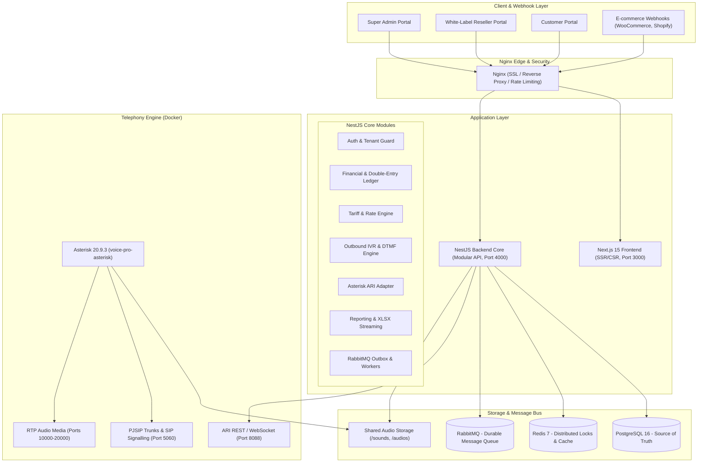

# SYSTEM ARCHITECTURE — Advanced Voice SMS & Outbound IVR SaaS

**Platform:** Voice Broadcast Pro SaaS  
**Domain:** `vsms.ominaz.com`  
**Revision:** 2.0 (Enterprise Multi-Tenant)

---

## 1. System Overview

The platform is designed as an enterprise-grade, multi-tenant, white-label SaaS for Automated Voice SMS and Outbound IVR campaigns.

---

## 2. Core Subsystems

### 2.1 Multi-Tenant White-Label Hierarchy
- **Lineage Path Model:** Every `User` has a `path` property (`root_id/reseller_id/customer_id`) and `depth`.
- **Tenant Scope Enforcement:** All database operations, campaign queues, CDR views, audio assets, and financial ledgers strictly enforce tenant boundary constraints.
- **Custom Branding:** Resellers configure custom domains, logos, theme colors, and portal metadata.

### 2.2 Financial & Tariff Engine
- **Prepaid Wallet & Credit Limits:** Balances are reserved atomically (`reservedBalance`) before calls are queued.
- **Immutable Ledger:** Every transaction creates a `LedgerEntry` with `balanceBefore`, `balanceAfter`, and a unique `idempotencyKey`.
- **Wholesale & Retail Tariffs:** 
  - Platform -> Reseller: Wholesale rate per pulse.
  - Reseller -> Customer: Retail rate per pulse with optional customer rate overrides.
- **Settlement Logic:**
  - Upon call hangup, billable duration is calculated according to pulse size (e.g. 10s or 1s).
  - Unused reserved funds are instantly released back to available balance.
  - True provider cost is recorded alongside selling price for accurate margin calculation.

### 2.3 Asterisk ARI Telephony Adapter
- **Protocol:** Asterisk REST Interface (ARI) over WebSocket and HTTP.
- **Stasis Application:** `VoiceProStasis`.
- **Call Origination:** Originated directly to PJSIP carrier endpoints (e.g., `PJSIP/<number>@<trunk>`).
- **Real-Time Event Processing:**
  - `StasisStart`: Channel answered, initiates audio playback or TTS.
  - `ChannelDtmfReceived`: Ingests user keypad presses (1: Confirm, 2: Cancel, 3: Callback, 0: Agent Transfer).
  - `PlaybackFinished`: Transitions flow to prompt repeat or graceful hangup.
  - `ChannelHangupRequest` / `StasisEnd`: Gathers final CDR metrics and triggers financial settlement.

### 2.4 Outbound IVR & Automated Order Confirmation
- **Flow Engine:** State machine handling prompts, retries, and fallback actions.
- **Order States:**
  - `CONFIRMED`: Customer pressed 1 -> Triggers verified merchant webhook.
  - `CANCELLATION_REQUESTED`: Customer pressed 2 -> Tagged for manual review or automated cancellation based on reseller policy.
  - `CALLBACK_SCHEDULED`: Customer pressed 3 -> Schedules queued automated callback.
  - `TRANSFERRED`: Customer pressed 0 -> Bridges to agent extension or call center SIP URI.
  - `NO_INPUT` / `INVALID`: Repeats up to configurable `maxAttempts` (default: 2), then executes fallback.

---

## 3. Asynchronous Worker Architecture (RabbitMQ)

Durable queues with Dead Letter Exchanges (DLX):
1. `campaign.dispatch`: Batches campaign contacts and reserves funds.
2. `call.originate`: Throttles calls per trunk concurrency limit.
3. `order.webhook`: Dispatches webhook callbacks with exponential retry.
4. `report.export`: Streams large dataset reports into formatted `.xlsx` files without blocking HTTP requests.
